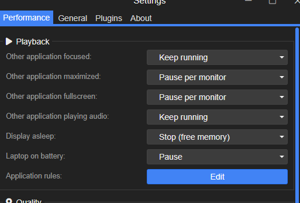

# Wallflow ✨

A smooth wallpaper selector for **Wallpaper Engine on Windows**. Open it, scroll until something looks good, apply it, and get back to your desktop.

[**Download for Windows**](https://github.com/Arsitur/Wallflow/releases/latest) · [Getting started](#getting-started) · [Controls](#controls) · [Developer guide](docs/DEVELOPMENT.md)

## Demo

**Demo video goes here.** I will add a quick showcase of Wallflow in action.

<!-- Replace the paragraph above with your Wallflow demo video link after uploading it. -->

## From the author

I watched [this YouTube video](https://www.youtube.com/watch?v=kYZ5mkGuQEg), saw that smooth wallpaper selector, and really wanted something like it on my own desktop. So I built this.

Normally, I do not vibe-code entire applications. This time I was tired, wanted the thing to exist, and decided to see what GPT-6.1 could do. The result is an entirely vibe-coded app, tested and adjusted until it worked the way I wanted.

Future maintainers: I am sorry 💀

I tested it briefly on **Windows 11 with two monitors**, and it works on my setup. Good luck 🫡

— [Arsitur](https://github.com/Arsitur)

## What it does

- A transparent, animated carousel with smooth scrolling, dragging and keyboard navigation.
- Optional **Amazing animations** setting: preview artwork pans smoothly from left to center to right as its card moves, without loading extra images. Enabled by default and respects reduced-motion preferences.
- Workshop wallpapers and local Wallpaper Engine projects, with playlists shown in their saved order.
- Quick blurred cover previews while higher-resolution artwork loads.
- Opens on the display you are using and starts at its current wallpaper when that wallpaper belongs to your selected playlist.
- Preserves playback and mute state by default, restores saved wallpaper properties, and can synchronize your playlist with Wallpaper Engine.
- Starts quietly in the system tray. Choose a wallpaper and the selector fades away immediately while the change finishes in the background.
- Separate Settings and Logs / Debugger windows, a configurable shortcut, and optional silent startup with Windows.

## Getting started

You need **Steam and Wallpaper Engine installed**, plus some downloaded wallpapers. Wallflow is a companion to Wallpaper Engine; both applications need to be running for normal use.

1. Download **`Wallflow_<version>_x64-setup.exe`** from [Releases](https://github.com/Arsitur/Wallflow/releases/latest), under **Assets**.
2. Run the installer. It installs for your Windows account and handles WebView2 automatically if it is missing.
3. Start Wallpaper Engine, then launch Wallflow. Wallflow stays in the notification area without opening the selector.
4. Press **Ctrl + Alt + G**.
5. Right-click the Wallflow tray icon → **Settings** to choose a playlist or record your own shortcut.

**No Node.js, Rust or terminal setup is needed to use the installer.**

Wallflow communicates with Wallpaper Engine through its installed executable. Those commands can start Wallpaper Engine if it is closed; starting Engine yourself first gives the most predictable experience. Launching Wallflow into the tray alone does not explicitly start Engine.

For automatic launch at sign-in, enable **Start with Windows** in Settings and choose **Save**. It is off by default, and the selector stays hidden at startup. A shortcut to the executable in your Windows Startup folder also works; use one startup method.

To update, quit Wallflow from the tray and run the new installer. To uninstall, use Windows Settings → Apps.

The builds are currently unsigned, so Windows may show a SmartScreen / unknown-publisher prompt. Download availability depends on a published release; the source-code ZIP is for building the app yourself.

## Controls

| Gesture | Action |
| --- | --- |
| **Ctrl + Alt + G** | Show / hide the selector; configurable in Settings |
| Mouse wheel, trackpad, or drag left / right | Browse wallpapers |
| **← / →** or **A / D** | Move one wallpaper |
| Left-click a card | Apply that wallpaper |
| Right-click anywhere in the selector | Apply the **currently centered** wallpaper |
| **Enter / Space** | Apply the centered wallpaper |
| **R** | Rescan the installed library |
| **Esc / Alt + F4** | Hide the selector |
| Switch to another application | Hide the selector |
| Left-click the tray icon | Open the selector |
| Right-click the tray icon | Settings, Logs / Debugger, or Quit |

To change the global shortcut, focus its field in Settings and press the combination you want. Choose **Save** to apply it.

## Wallpaper Engine settings I use

For anyone wondering, this is the playback setup I tested with:

| Wallpaper Engine → Settings → Performance | Value |
| --- | --- |
| Other application focused | Keep running |
| Other application maximized | Pause per monitor |
| Other application fullscreen | Pause per monitor |
| Other application playing audio | Keep running |
| Display asleep | Stop (free memory) |
| Laptop on battery | Pause |

These are the settings I tested; other combinations are unverified.

**Playlist timers still belong to Wallpaper Engine.** A very short automatic-change interval can switch the wallpaper while you are browsing the selector. For the nicest experience, use a longer interval or disable automatic changes.

## A few things to know

- **Two monitors work on my setup.** More than two monitors are untested. Windows 11 is the tested OS; other Windows setups have not been verified by me.
- **Use the Steam version of Wallpaper Engine.** Other installation types, including unofficial copies, are untested and unsupported.
- **Loose video files are not picked up by the library scan.** For a personal video, create a local project in the Wallpaper Engine editor, then add it to your playlist. Video wallpapers packaged as projects are supported.
- **Wallpaper Engine's built-in default wallpapers are intentionally excluded.**
- **Save your playlist in Wallpaper Engine after editing it**, including after adding a scene. Some additions can appear live before saving, but saving is needed for reliable synchronization of a named playlist.
- **Scene covers are static artwork previews.** They can differ from the fully animated scene, and some projects fall back to their author's preview. Higher-resolution video covers use FFmpeg if it is already installed; it is optional.
- **Settings → Preserve playback and mute state** is enabled by default. Leave it on if you want your pause / mute choices to carry across wallpaper changes.
- If a change fails, check **Logs / Debugger** from the tray menu. Logs include local file paths, so review them before sharing.

## For the full desktop look

It looks ridiculously good with [TranslucentTB](https://github.com/TranslucentTB/TranslucentTB) and a clean desktop.

I use **Ctrl + Space** to toggle desktop icons through Wallpaper Engine. Configure that in Wallpaper Engine's hotkey settings; it is separate from Wallflow's shortcut. TranslucentTB is optional and installed separately.

## Built with

**Svelte · Tailwind CSS · Vite · Tauri 2 · Rust**

Curious about the code, or want to build an installer? See the [developer guide](docs/DEVELOPMENT.md), including the path from a wallpaper click to the actual CLI command.

## Forks, fixes and expectations

You are welcome to fork this, adapt it, and make it work for your setup.

I made it because I wanted it. I am not planning to actively maintain this project or provide ongoing support, so if you want to work on it: go for it. Future maintainers, once again, my condolences.

## License and a small request

Released under the [MIT License](LICENSE).

If you use this in a professional context, I would appreciate a credit to **Arsitur** somewhere. That is enough to fulfill my inner Buddhist monk.

Good luck, mon ami. 🫡
